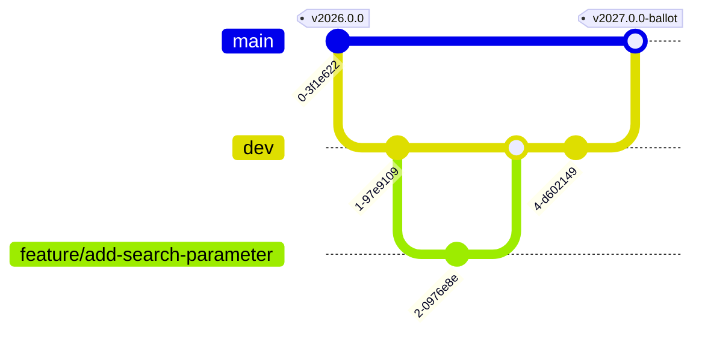

# Contributing

Thank you for contributing to the MII Kerndatensatz module **Meta**! This page
explains the branching model, the commit convention and how a change reaches a
release. The workflows behind it are described in
[`docs/workflows.md`](docs/workflows.md); task-shaped guides are in
[`docs/recipes/`](docs/recipes/README.md).

## Branching model

Two long-lived branches, short-lived working branches:

- **`main` — release branch.** Holds the released (or release-ready) state and
  is the **default branch**. Changes arrive only through the `dev → main`
  release merge. `main` is never previewed; formal publications go to the root
  of the GitHub Pages site via `go-publish.yml`.
- **`dev` — integration branch.** Where reviewed changes accumulate between
  releases. Every push deploys a preview to
  [`branches/dev/`](https://medizininformatik-initiative.github.io/kerndatensatz-meta/branches/dev/),
  the IG's `ci-build` location.
- **`release/vYYYY.n.n` — release-preparation branches** (optional). The
  `release/**` name arms the convention check's strict release mode; see
  [docs/release.md](docs/release.md).
- **`feature/*`, `change/*`, `fix/*`, `chore/*` — short-lived working
  branches.** Branched **off `dev`**, one focused change each, merged back into
  `dev` via PR, then deleted. Every push gets its own preview under
  `branches/<branch>/`, linked from the PR.
- **Do not delete** `master` (reusable validation workflows other modules
  still call), `gh-pages` (the published site) or `fsh-generated` (the
  Simplifier mirror).



### Flow — making one change

1. Branch `feature|change|fix/<topic>` off `dev`.
2. Commit using Conventional Commits (cheat-sheet below); open a PR
   **targeting `dev`**.
3. On green CI (preview build, SearchParameter tests, convention check) and a
   review, **squash-merge** into `dev` and delete the branch.
4. To release: open a **`dev` → `main` PR** (the release gate, a human
   decision) and merge it as a **merge commit, not a squash**, so the
   individual commits stay visible on `main`. Then tag the CalVer version —
   see [docs/recipes/cut-a-release.md](docs/recipes/cut-a-release.md).

### Back-merge rule

If something has to go straight into `main` — a fix that cannot wait for the
next release — the change is not finished until `main` has been merged back
into `dev` (as a merge commit). Check before branching:

```bash
git fetch origin
git log --oneline origin/dev..origin/main   # must print nothing
```

## Versions

The module is released with **CalVer `YYYY.n.n`** (pre-releases such as
`2027.0.0-ballot`) through the MII Module Release Workflow
(`module-release.yml`, then the human-gated `go-publish.yml`). The version in
`sushi-config.yaml`, `package.json` and `publication-request.json` must agree.
Commit types do not compute the version — the release owner sets it.

## Conventional Commits — cheat-sheet

Every commit message (and PR title, since PRs are squash-merged) follows
[Conventional Commits](https://www.conventionalcommits.org/en/v1.0.0/):
`<type>: <short description>` — for example `feat: add asserted-date search parameter`.

| Type | Use for |
| --- | --- |
| `feat` | New or changed FHIR content (profile, search parameter, code system entry, page) |
| `fix` | A correction (wrong FHIRPath expression, typo, broken link) |
| `docs` | Maintainer documentation only |
| `ci` | Workflow changes |
| `build` | Toolchain pins (SUSHI, IG Publisher, Jekyll, dependencies) |
| `chore` | Housekeeping (configs, branch merges, clean-ups) |
| `refactor` | Restructuring without a change in the published content |
| `test` | Adding or fixing tests (e.g. SearchParameter tests) |

Mark a breaking change with `!` after the type (`feat!: …`) and explain the
break in the commit body.

## Pull request expectations

- One focused change per PR; keep diffs reviewable.
- PRs target `dev`.
- Every English page under `input/pagecontent/` has a German mirror with the
  same file name under `input/translations/de/pagecontent/`; change both.
- A new or changed SearchParameter comes with a test in
  `.github/workflows/search-param-test/test-search.sh`.
- Do not commit generated output (`fsh-generated/`, `output/`, `translations/`).
- CI must be green before merge.
- Please follow the [Code of Conduct](CODE_OF_CONDUCT.md).

## How this relates to the MII process

Everything above is **this repository's** workflow. It is not an MII rule, and
this repository does not speak for the MII.

The MII does publish rules for commenting on a Kerndatensatz module, and this
module sits inside them. They are in
the [**KDS governance, version 4.0 (7 May 2026)**](https://www.medizininformatik-initiative.de/sites/default/files/2026-07/KDS-Governance-v4.pdf),
adopted by the National Steering Committee and linked from the
[MII core-data-set page](https://www.medizininformatik-initiative.de/en/medical-informatics-initiatives-core-data-set):

- **Where comments go.** After FHIR profiling, a module runs a commenting round.
  Comments are filed either through the HL7 Deutschland ballot portal **or as an
  issue in the module's own GitHub repository** (§5.1.2) — so a module's issue
  tracker is a sanctioned channel, not an informal one.
- **Who may comment, and for how long.** Anyone may comment; the round is
  announced in advance and runs for a defined window (§3.5.4). Voting on an HL7
  ballot is a separate matter and is restricted to HL7 Deutschland members.
- **The module team must answer.** Every comment is answered — accepted or
  rejected, with a reason (§3.5.4).
- **Comments are public by default.** A commenter may ask for their identity to
  be pseudonymised.

Two things the MII does **not** publish, which are worth knowing so you do not
go looking:

- **No code of conduct**, anywhere — see [CODE_OF_CONDUCT.md](CODE_OF_CONDUCT.md).
- **No `CONTRIBUTING.md` for a KDS module** — not in the reference module
  `kerndatensatz-basis`, not in any other `kerndatensatz-*` repository, and not
  as an organisation-level default. (A couple of the MII's *software* repos
  carry one; no core-data-set module does.) The one participation rule
  published organisation-wide is how to request GitHub access, on the
  [MII organisation profile](https://github.com/medizininformatik-initiative/.github/blob/main/profile/README.md):
  email the Geschäftsstelle with the subject *"Zugang zum GitHub der MII"*.

> **Cite version 4.0, not what you may find first.** The
> `medizininformatik-initiative/kerndatensatz-governance` repository still
> announces version 3, ships no document and has not been touched since January
> 2024. Version 3.0's tooling chapter — GitHub, SharePoint, Simplifier, Zulip
> access — was **removed** in 4.0 and replaced by an appendix marked *in
> Arbeit*, so those instructions are no longer published guidance.
